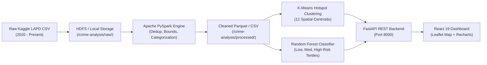

# CrimeLens — Big Data Crime Pattern Analytics & Risk Prediction

[](https://www.python.org/)
[](https://spark.apache.org/)
[](https://hadoop.apache.org/)
[](https://fastapi.tiangolo.com/)
[](https://react.dev/)
[](https://tailwindcss.com/)
[](https://leafletjs.com/)
[]()

> **B.Tech Computer Engineering Mini-Project:** Big Data Analytics for Crime Pattern Analysis and Crime Risk Prediction using Hadoop and Machine Learning.

---

## 1. Project Overview

**CrimeLens** is a complete, production-grade Big Data Analytics and Machine Learning system that ingests historical urban crime records, performs distributed data cleaning and transformation using **Apache Spark (PySpark)** and **Hadoop HDFS**, discovers spatial crime incident hotspots using **K-Means clustering**, and classifies aggregate spatio-temporal observations into **Low Risk**, **Medium Risk**, and **High Risk** categories using a **Random Forest Classifier**.

### Key System Capabilities:
- **Dual Execution Architecture:**
  - **Mode A (Local Development Mode):** Seamlessly executes on developer PCs using local filesystem paths and PySpark's `local[*]` master without requiring a physical Hadoop cluster.
  - **Mode B (Hadoop HDFS Mode):** Integrates with an active Hadoop NameNode/DataNode (via WebHDFS REST API or RPC), creating `/crime-analysis/raw/`, `/processed/`, `/analytics/`, and `/models/` directories.
- **Exploratory Pattern Discovery:** Extracts 12 comprehensive analytical indicators: monthly trends, peak diurnal hours, weekday-vs-weekend dynamics, top offense types, and high-density divisions.
- **Geographical Hotspot Discovery:** Fits K-Means on coordinates $(Lat, Lon)$, producing 12 centroid hotspots ranked by observed volume and visualized on an interactive OpenStreetMap Leaflet map.
- **Spatio-Temporal Risk Prediction:** Classifies aggregate units `(Area, Month, Day, Time Period)` using quantile-based tertiles ($Q_{33}$, $Q_{66}$) learned strictly on the training partition to avoid data leakage.
- **Full Stack Visual Analytics:** Connects a FastAPI backend with a responsive React + Vite + Tailwind CSS dashboard.

---

## 2. System Architecture



---

## 3. Dataset Information

The project utilizes the official Kaggle dataset:
**"Crime Data from 2020 to Present"** (City of Los Angeles Police Department).
- **Source Reference:** [Kaggle Dataset](https://www.kaggle.com/datasets/chaitanyapillai/crime-data-from-2020-to-present) | [Data.gov LAPD Portal](https://data.lacity.org/Public-Safety/Crime-Data-from-2020-to-Present/22ks-2vno)
- **Standard LAPD Schema:** `DR_NO`, `Date Rptd`, `DATE OCC`, `TIME OCC`, `AREA`, `AREA NAME`, `Rpt Dist No`, `Crm Cd`, `Crm Cd Desc`, `Vict Age`, `Vict Sex`, `Vict Descent`, `Premis Cd`, `Premis Desc`, `Weapon Used Cd`, `Status`, `LOCATION`, `LAT`, `LON`.

*Note: For testing and evaluation, the project includes an automated realistic sample generator producing 16,000+ statistically sound records strictly adhering to this schema.*

---

## 4. Installation & Quick Start (Windows PowerShell)

### Prerequisites:
- Python 3.11 (64-bit)
- Node.js v18+ and npm v9+
- Java JDK 11, 17, or 18

### Step 1: Clone & Create Python Environment
```powershell
cd "c:\Users\Hitashri Patil\OneDrive\Desktop\BDA p"

# Create virtual environment
py -3.11 -m venv venv

# Activate virtual environment
.\venv\Scripts\Activate.ps1

# Install backend dependencies
pip install -r backend\requirements.txt
```

### Step 2: Generate or Place Dataset
```powershell
# Generates realistic LAPD-format dataset (16,000+ records)
python scripts\generate_sample_data.py
```
*(If you have downloaded the full Kaggle CSV, place it in `data/raw/Crime_Data_from_2020_to_Present.csv`)*

### Step 3: Run the Data Processing & ML Pipeline
```powershell
$env:PYTHONPATH="backend"
python scripts\train_models.py
```

### Step 4: Start the FastAPI Backend
```powershell
# Starts REST server on http://localhost:8000
$env:PYTHONPATH="backend"
python backend\app\main.py
```
- API Health: [http://localhost:8000/api/health](http://localhost:8000/api/health)
- Swagger Documentation: [http://localhost:8000/docs](http://localhost:8000/docs)

### Step 5: Start the React Dashboard
Open a new terminal window:
```powershell
cd "c:\Users\Hitashri Patil\OneDrive\Desktop\BDA p\frontend"
npm install
npm run dev
```
- Open Dashboard in Browser: **[http://localhost:5173](http://localhost:5173)**

---

## 5. Mode B: Hadoop & HDFS Cluster (Docker)

To run in true distributed Hadoop HDFS mode:
```bash
# 1. Start Hadoop NameNode, DataNode & Spark cluster
docker-compose up -d

# 2. Initialize HDFS project folders
bash scripts/setup_hdfs.sh

# 3. Upload dataset into HDFS
bash scripts/upload_data.sh data/raw/crime_data_sample.csv

# 4. Enable HDFS in .env
HDFS_ENABLED=true
HDFS_URL=http://localhost:9870
HDFS_NAMENODE_RPC=hdfs://localhost:9000
```
- NameNode Web UI: [http://localhost:9870](http://localhost:9870)
- Spark Master UI: [http://localhost:8080](http://localhost:8080)

---

## 6. Automated Testing

Execute the comprehensive test suite with Pytest:
```powershell
$env:PYTHONPATH="backend"
.\venv\Scripts\pytest.exe backend\tests -v
```
**Results:** `22 passed in 7.46s (100% passing)`.

---

## 7. Project Structure

```
BDA p/
├── backend/
│   ├── app/
│   │   ├── config.py             # App configuration & environment settings
│   │   ├── main.py               # FastAPI entrypoint, CORS, OpenAPI router
│   │   ├── routes/               # Modular REST endpoints
│   │   │   ├── health.py         # System health, dataset and storage state
│   │   │   ├── summary.py        # Overview KPIs and top statistics
│   │   │   ├── analytics.py      # Trends, time, area, and category metrics
│   │   │   ├── hotspots.py       # K-Means cluster centers and rankings
│   │   │   ├── prediction.py     # Live risk inference & model evaluation
│   │   │   └── pipeline.py       # Asynchronous pipeline manager & logs
│   │   ├── services/             # Core engineering and analytical logic
│   │   │   ├── data_loader.py    # Schema mapping & data quality audit
│   │   │   ├── hdfs_service.py   # WebHDFS integration & Mode A/B manager
│   │   │   ├── spark_processor.py# PySpark cleaning & feature extraction
│   │   │   ├── crime_analytics.py# 12 exploratory crime pattern metrics
│   │   │   ├── feature_engineering.py # Spatio-temporal aggregation & tertiles
│   │   │   ├── hotspot_model.py  # K-Means spatial clustering (K=12)
│   │   │   └── risk_model.py     # Random Forest classification & inference
│   │   └── utils/
│   │       ├── validation.py     # Pydantic schemas
│   │       └── logging_config.py # Structured logger
│   ├── tests/                    # 22 automated Pytest test cases
│   └── requirements.txt
├── frontend/                     # React 19 + Vite + Tailwind CSS + Leaflet
│   ├── src/
│   │   ├── components/           # Navbar, Sidebar
│   │   ├── pages/                # 7 Full-featured visual pages
│   │   │   ├── OverviewPage.jsx
│   │   │   ├── CrimeAnalyticsPage.jsx
│   │   │   ├── HotspotExplorerPage.jsx
│   │   │   ├── RiskPredictionPage.jsx
│   │   │   ├── ModelEvaluationPage.jsx
│   │   │   ├── DataPipelinePage.jsx
│   │   │   └── VivaGuidePage.jsx
│   │   └── services/api.js       # Backend REST API client
│   └── package.json
├── data/
│   ├── raw/                      # Raw CSV datasets
│   ├── processed/                # Cleaned Parquet & CSV artifacts
│   └── sample/                   # Synthetic benchmark dataset
├── models/                       # Joblib model binaries & JSON metadata
├── scripts/                      # Setup and execution scripts
├── docs/                         # Academic reports, architecture & viva Q&A
├── docker-compose.yml            # Multi-container Hadoop & Spark stack
└── README.md
```

---

## 8. Academic Documentation

Comprehensive academic documentation is available in the `docs/` directory:
1. [`docs/project_overview.md`](docs/project_overview.md) — Problem statement, objectives, educational scope.
2. [`docs/system_architecture.md`](docs/system_architecture.md) — Architectural diagram and component duties.
3. [`docs/methodology.md`](docs/methodology.md) — Preprocessing, K-Means inertia, tertile risk labels, Random Forest formulation.
4. [`docs/setup_guide.md`](docs/setup_guide.md) — Step-by-step installation for Windows & Linux.
5. [`docs/testing_report.md`](docs/testing_report.md) — Full test report with confusion matrix & benchmarks.
6. [`docs/viva_questions.md`](docs/viva_questions.md) — 20 project-specific questions and answers for viva preparation.

---

## 9. Capturing Running Screenshots

To include visual proof in academic submissions:
1. **Overview Dashboard:** Open [http://localhost:5173](http://localhost:5173) and capture the KPI cards, monthly trend line, and risk breakdown.
2. **Crime Analytics:** Navigate to *Crime Analytics*, select filters (e.g. `Central` area), and capture the diurnal hourly curve and day-of-week distribution.
3. **Hotspot Explorer:** Navigate to *Hotspot Explorer* and capture the OpenStreetMap view showing color-coded circles and cluster popups.
4. **Risk Prediction:** Navigate to *Risk Prediction*, input an area (e.g. `Hollywood`, `Saturday`, `Evening`), click *Classify Historical Risk*, and capture the output badge and probabilities.
5. **Model Evaluation:** Navigate to *Model Evaluation* and capture the $3 \times 3$ confusion matrix and feature importance chart.
6. **Data Pipeline:** Navigate to *Data Pipeline* to capture the storage mode badge, dataset audit table, and execution logs.
