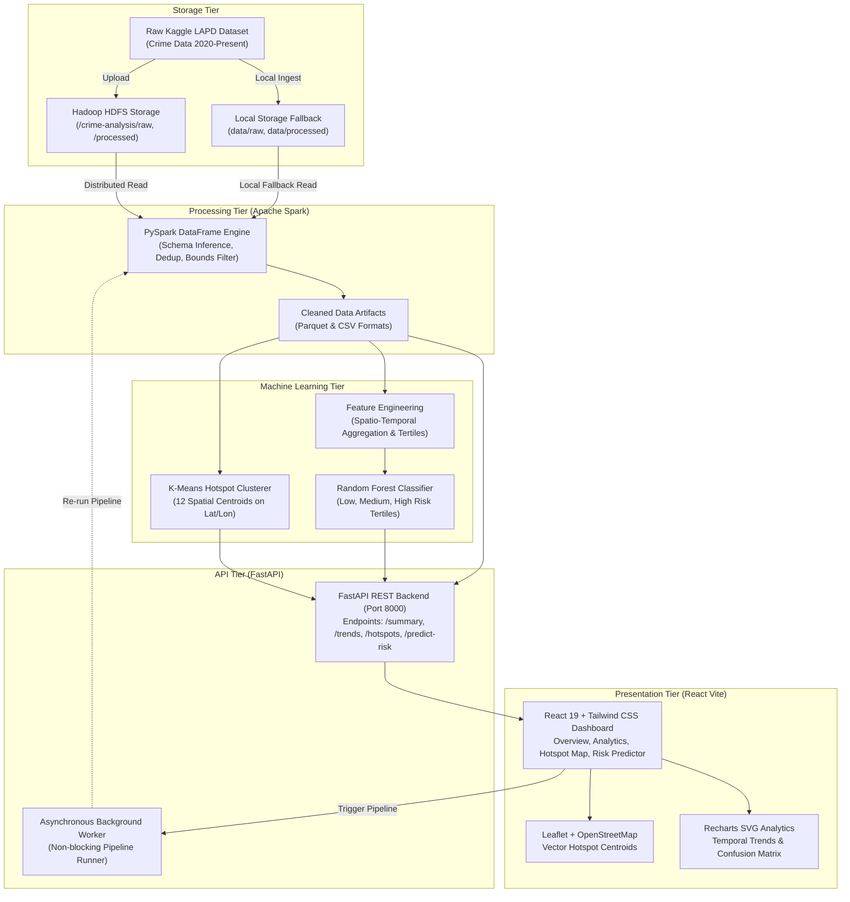

# System Architecture & Component Design

## 1. Architectural Overview

The Crime Pattern Analytics platform follows a decoupled, multi-tiered Big Data architecture comprising Ingestion, Distributed Storage, Distributed Processing, Machine Learning, REST APIs, and Visual Analytics.

---

## 2. Component Responsibilities

### A. Data Ingestion & Storage (`HDFSService` & `DataLoader`)
- **Location:** `backend/app/services/hdfs_service.py`, `backend/app/services/data_loader.py`
- **Role:** Handles both local CSV files and Hadoop HDFS distributed directories.
- **HDFS Project Structure:**
  - `/crime-analysis/raw/`: Original uncleaned CSV records.
  - `/crime-analysis/processed/`: Standardized Parquet files.
  - `/crime-analysis/analytics/`: JSON summary files for rapid API retrieval.
  - `/crime-analysis/models/`: Serialized Joblib model binaries.
- **Resilience:** Implements automatic connectivity verification via WebHDFS REST API. If Hadoop is not active, the system automatically falls back to local storage and logs: `"Mode A: Local Development Mode"`.

### B. Distributed Processing (`SparkProcessor`)
- **Location:** `backend/app/services/spark_processor.py`
- **Role:** Primary data transformation engine using PySpark DataFrames.
- **Transformations:**
  - `dropDuplicates(["DR_NO"])`: Eliminates redundant records.
  - Geographic Bounding Box Filter: Filters records strictly within Los Angeles County coordinates ($33.65 \le \text{Lat} \le 34.40$ and $-118.75 \le \text{Lon} \le -118.10$), stripping out $(0.0, 0.0)$ placeholder artifacts.
  - Temporal Decomposition: Extracts `year`, `month`, `day_of_week`, `hour`, `time_period`, and `is_weekend`.
  - Normalized Category Assignment: Maps hundreds of granular LAPD crime descriptions into standardized legal categories.

### C. Machine Learning Engine
- **K-Means Hotspot Clusterer (`HotspotModel`):**
  - Uses standardized coordinates to partition observations into $K=12$ geographical clusters.
  - Computes cluster centroids, observed incident density, dominant crime types, and ranks hotspots from #1 to #12.
- **Random Forest Risk Classifier (`RiskClassificationModel`):**
  - Aggregates records into spatio-temporal units: `(Area Name, Month, Day of Week, Time Period)`.
  - Derives quantile risk labels strictly on the training partition ($Q_{33}$ and $Q_{66}$).
  - Trains an ensemble of 100 decision trees to predict risk categories with balanced class weighting.

### D. REST API (`FastAPI`)
- **Location:** `backend/app/main.py`, `backend/app/routes/`
- **Role:** High-performance asynchronous API server providing JSON responses, CORS handling, Pydantic input validation, and interactive Swagger documentation at `/docs`.

### E. Frontend Dashboard (`React + Vite`)
- **Location:** `frontend/src/`
- **Role:** Responsive dark-themed dashboard built with React, Tailwind CSS, Recharts, and Leaflet. Connects directly to backend REST endpoints.
